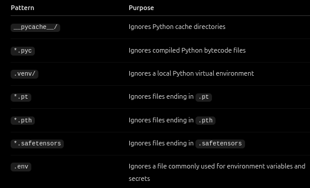
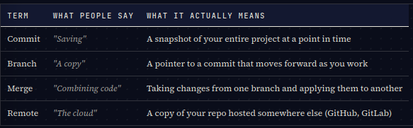

## learning objectives.
## git collaboration.
## note: this lesson teaches how to save code, track changes.
configure git identity and use the daily workflow of add,commit and push back up work to github, and collaborate without breaking your project.

## step 1
* git 
git is a version control system that tracks changes in yor code over time. (with git you can track previous version of your project and return to them when neccessary, without git you might struggle to recover your previous work)

* what is version control.
it means keeping track of changes mad to file over time.

for example:
- Version 1: You create a ticket.
- Version 2: You add ticket assignment.
- Version 3: You add an audit history.
- Version 4: You accidentally break ticket assignment.

- git add select things
- git commit save a snapshot in your local git history
- git push uupload your commit to the remote repository.

## step 2.
-  github does not automatically fix bugs. it helps you track changes and recover earlier versions.

## step 3
- the four main parts to understand.
 - a repository is a collection of files and their complete change history managed by version control
1. working directory is the folder containning your project files.
2. staging area is the changes you have selected for you next commit.
3. local repository is when you commit changes, then git records a snapshot to your local repository 
4. remote repository is another copy  of your repository hosted somewhere.

## step 4
* configure git: before using git configure the name and email associated with your commits.
- what does global mean: it mean the configuration applies to your git repository by default for your user account on that computer.

## step 5
- the daily git workflow is hte step by step process of tracking code code changes, saving project history and collaborating with others.#

## step 6
 git branch is a seperate line of development that allows you to work on a feature without directly changing another branch such as main.
Why use branches?
Branches help you:
- Develop new features independently.
- Experiment without directly changing main.
- Fix bugs without mixing unrelated changes.
- Prepare changes for review before integrating them.

note: branches does not automatically protect you from every mistake, you still need to commit you work carefully and test your changes.

## step7
 what are clone, fork and pull
- cloning downloads a rwepository to you computer
-fork is a copy of your repository created under your own github account.
Suppose another developer owns a project, and you want to contribute but don't have permission to push directly to their repository.
You can:
1. Fork their repository on GitHub.
2. Clone your fork.
3. Create a branch.
4. Make changes and commit them.
5. Push your branch to your fork.
6. Open a pull request asking the original project's maintainers to review your changes.
Remember the distinction: Forking happens on GitHub; cloning brings a repository to your computer

- git pull fetches changes from a remote repository and integrates it into your currrent branch.

- git fetch it downloads information about new commit and branch from a remote without automatically integrating those changes into your current branch.

## step 8
- .gitignore you tell git which untracked files to ignore
You generally don't want to commit every file generated by your project.
For example, Python projects may generate cache files. AI projects may contain large model checkpoints that are better stored separately.

## step 9
every commit becomes part of your repository history, to see it you run this command (git log --oneline)

-
Command	Purpose
- git status:	Check the current state of your files
- git add: file.py	Stage a file's changes
- git commit -m "message":	Record staged changes in the localhistory
- git push: Upload local commits to a remote
- git pull: Fetch and integrate remote changes
- git fetch: Download remote updates without integrating them
- git clone URL: Clone a repository to your computer
- git checkout -b branch-name: Create and switch to a new branch
- git checkout main: Switch to the main branch
- git merge branch-name: Merge another branch into the current branch
- git log --oneline: View compact commit history
- git branch: List local branches

